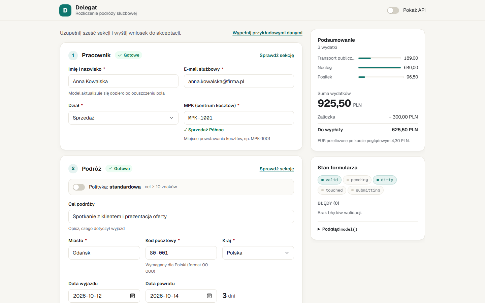

<div align="center">

# Delegat

**A business-trip expense claim built on Angular Signal Forms**

A small, realistic app that exercises almost the entire `@angular/forms/signals` API in a single form — from validators, through schemas and dynamic fields, to custom controls without `ControlValueAccessor`.

[](https://github.com/<user>/signal-forms-delegat/actions/workflows/deploy.yml)


[**▶ Live demo**](https://<user>.github.io/signal-forms-delegat/)



</div>

---

## What it is

An employee settles a business trip: enters their details, the trip purpose and dates, adds any number of expenses (ticket, private car, hotel, meal), picks a payout method and sends the claim for approval. The backend is simulated by an HTTP interceptor, so the whole thing runs as a static site on GitHub Pages.

The UI is in Polish (the business scenario is Polish delegation rules); code, identifiers and docs are in English.

Turn on the **„Pokaż API”** (Show API) toggle in the header — every field gets a badge naming the Signal Forms features that drive it. The side panel shows the live form state (`valid`, `pending`, `dirty`, `touched`, `submitting`) and an error list that jumps to the offending field.

## What it shows

Paths are relative to `src/app/`.

| Area | API | Where in the app |
|---|---|---|
| Model as the source of truth | `form()`, `FormField`, `FormRoot` | `claim/claim-form.ts` |
| Built-in validators with messages | `required`, `email`, `pattern`, `min`, `max`, `minLength`, `maxLength` | employee data, IBAN, km — `claim/claim-form.ts`, `claim/schemas/expense.schema.ts` |
| Conditional validation | `required(…, { when })` | receipt above 100 PLN, Polish postal code, department fields — `claim/schemas/*.ts`, `claim/claim-form.ts` |
| Cross-field validation | `validate()` + `valueOf()` | trip dates, expense date within the trip, approver ≠ employee — `claim/claim-form.ts` |
| Error on another field | `validateTree()` | advance larger than the expense total — `claim/claim-form.ts` |
| Async validation | `validateHttp()` with `debounce` | cost-center (MPK) lookup — `claim/claim-form.ts`, `claim/sections/employee-section.component.ts` |
| Zod / Standard Schema | `validateStandardSchema()` (dynamic) | "standard / strict" travel policy switch — `claim/schemas/trip.zod.ts` |
| Reusable schemas | `schema()`, `apply()`, `applyEach()`, `applyWhen()` | address, expenses, per-category rules — `claim/schemas/address.schema.ts`, `claim/schemas/expense.schema.ts` |
| Field state | `hidden()`, `disabled()` with a reason, `readonly()` | category-dependent fields, currency, advance — `claim/schemas/expense.schema.ts`, `claim/claim-form.ts` |
| Deferred updates | `debounce(300)`, `debounce('blur')` | notes, full name — `claim/claim-form.ts`, `claim/sections/approval-section.component.ts` |
| Field metadata | `metadata()`, `createMetadataKey()` | help texts and demo-mode badges — `claim/claim.metadata.ts`, `ui/field/field.component.ts` |
| Custom controls | `FormValueControl`, `FormCheckboxControl`, `transformedValue()` | money input, category picker, switch — `ui/controls/*.component.ts` |
| Dynamic controls | `model.update()` + `httpResource` | expense list, department-specific fields — `claim/sections/expenses-section.component.ts`, `claim/claim-page.component.ts` |
| Submission | `submission`, `ignoreValidators`, `onInvalid`, `errorSummary()`, `focusBoundControl()`, `submit()` | sending the claim, saving a draft — `claim/claim-form.ts`, `claim/claim-page.component.ts` |
| CSS classes | `provideSignalFormsConfig()` | `is-invalid`, `is-pending`, `is-dirty` — `app.config.ts` |

Every usage is marked in the code with a `// [SF]` comment — just run `grep -rn "\[SF\]" src`.

## Try it

| Enter | Result |
|---|---|
| cost center `MPK-1001` … `MPK-1005` | active cost center |
| cost center `MPK-9999` | inactive cost center (async validation error) |
| any other `MPK-0000` | „Nie znaleziono MPK” (not found) |
| trip purpose containing „duplikat” | server-side error on submit, shown under the purpose field |
| department `SALES` / `IT` / `OPS` | different sets of dynamic fields |
| an expense above 100 PLN | receipt number becomes required |

Or click **„Wypełnij przykładowymi danymi”** (fill with sample data). Opening the app with `?demo` pre-fills it (`?demo&api` also turns on the API badges).

## Running locally

```bash
nvm use            # Node version from .nvmrc
npm ci
npm start          # http://localhost:4200
```

| Script | Description |
|---|---|
| `npm start` | dev server |
| `npm run build` | production build to `dist/` |
| `npm run test:ci` | unit tests (Vitest) |
| `npm run lint` | ESLint |
| `npm run format` | Prettier |

## Structure

```
src/app/
├── core/       mock API, draft storage
├── claim/      model, schemas, form logic, sections, side panel
└── ui/         controls (money-input, category-picker, switch) and base components
src/styles/     tokens, base and form styles (light theme)
```

## Deploy

On every push to `main`, the `.github/workflows/deploy.yml` workflow runs lint, tests and the build, then publishes the app to GitHub Pages. Pull requests only run lint, tests and the build.

One-time setup: **Settings → Pages → Source: GitHub Actions**.

## API notes

Signatures were verified against `node_modules/@angular/forms/types/signals.d.ts` (Angular 22.2). Differences from the article and a few subtleties:

- **`disabled` / `hidden` / `readonly` take `{ when }`.** Passing a function directly (`disabled(path, () => …)`) is marked `@deprecated`. `disabled({ when })` may return a `string`, which ends up in `disabledReasons()`.
- **`metadata(path, key, logicFn)`** — the third argument is always a `LogicFn`, not a value. `createMetadataKey(MetadataReducer.list<string>())` collects multiple calls into an array — that is how `API_BADGE` works. Reading: `field().metadata(KEY)?.()` returns a `Signal`.
- **`minDate` / `maxDate`** work on `Date` values (an `<input type="date">` bound to a `Date` model). This app stores dates as ISO `string`s, so date ranges are checked in `validate()` by string comparison.
- **`required` treats `false` as empty** (checkbox semantics), so it is enough for the declaration. An empty array passes `required`, hence `minLength(f.expenses, 1)`.
- **`ignoreValidators: 'none'` does not wait** for async validators — while `pending()` it calls `onInvalid` immediately. Waiting is implemented in `onInvalid`: if the form is pending, it waits (`whenSettled`, an effect on `pending()`) and retries `submit()`.
- **`submit()` always calls `markAsTouched()`** on the submitted tree — including the draft save with `ignoreValidators: 'all'`, so errors become visible after „Zapisz szkic”.
- **`validateHttp`** only runs once the field's synchronous validators pass; a `request` returning `undefined` skips the call. The response is not available outside `onSuccess`, so the cost-center name shown in the UI is captured in `options.parse` (`CostCenterDirectory`).
- **`validateStandardSchema(path, schemaOrFn)`** accepts a lambda returning the schema — switching the Zod schema at runtime works without rebuilding the form. Zod issue paths (`path: ['endDate']`) map onto fields. The app uses `zod/mini` to keep the bundle smaller.
- **`transformedValue()`** is `linkedSignal(() => format(value()))`, so every valid model change re-formats the raw value. To avoid rewriting text under the cursor, `MoneyInputComponent` writes to the DOM only when unfocused and formats on `blur`. Parse errors are reported to the field automatically, and `FieldState.reset()` clears them (internal integration with `FormField`).
- **Attributes such as `min`/`max` are forbidden** on elements with `[formField]` (compiler error NG8022) — the values come from validators.
- **Native `<input type="date">` controls become `dirty()` on first render** (the validity monitor reports a value). The page calls `reset()` without a value after rendering to start from a pristine state.
- **`name()`** is derived from `form(…, { name: 'claim' })` (e.g. `claim.expenses.0.amount`) — it is used to build `id`, `aria-describedby` and the paths in the inspector.
- **`provideSignalFormsConfig({ classes })`** — each predicate receives a `FormFieldBinding`; state is read via `binding.state()`.

## Sources

- [Signal Forms — Complete Guide v21–22 (angular.love)](https://angular.love/signal-forms-in-angular-21-complete-guide)
- [Signal Forms documentation (angular.dev)](https://angular.dev/guide/forms/signals)

## License

MIT
